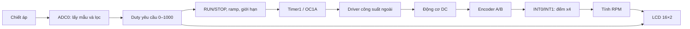

# ME4169E

Điều khiển tốc độ động cơ DC bằng ATmega8.

Project sử dụng C và AVR-GCC để đọc chiết áp bằng ADC, tạo lệnh PWM điều khiển tốc độ động cơ theo vòng hở, thu nhận encoder A/B bằng ngắt và hiển thị tốc độ trên LCD 16×2. Chương trình thao tác trực tiếp thanh ghi ATmega8, không sử dụng Arduino core hoặc hệ điều hành thời gian thực.

Mở `ME4169E.code-workspace` để sử dụng tên workspace **ME4169E** trong VS Code.

**Cấu hình hiện tại:** motor GA25-370 **12 V, 280 RPM**, encoder A/B cấp **5 V**, nguồn motor **12 V**, driver **L298 cầu B**, ATmega8 **8 MHz**, PWM **10 kHz**, RUN chạy thuận và STOP ưu tiên. Bản mặc định là `Release`, ngõ motor đã được mở trong chương trình; sau reset vẫn dừng và cần một lần nhấn RUN mới để chạy. Bản A/B x4 dùng **CPR danh nghĩa 937,2 count/vòng trục ra** để hiển thị `RPM~`; bản Hall x1 dùng 234,3. Dấu `~` cho biết hệ số lấy từ thông số shop, chưa đo trên motor. Vẫn có chế độ `C:` để hiệu chuẩn. Chưa nạp hoặc thử trên mạch thật.

Xem [đấu dây L298, lựa chọn encoder và hiệu chuẩn](Input/Motor_GA25_370.md) trước khi dùng HEX. ENB nhận PWM, cần bỏ jumper ENB của module và thêm kéo xuống 10 kΩ để tắt cầu khi MCU reset/nạp. Encoder lấy +5 V/GND tại Header3; motor nhận nguồn 12 V qua L298. Header4 chỉ mang A/B; R7/R8 không thay thế nguồn encoder.

## 1. Nội dung project và đối chiếu đề bài

```text
ME4169E/
├── README.md                 Nguyên lý, ngoại vi và cách sử dụng
├── ME4169E.code-workspace     Workspace VS Code mang tên ME4169E
├── .vscode/                  Cấu hình AVR IntelliSense và tác vụ build
├── Firmware/
│   ├── include/              Header và cấu hình tập trung trong config.h
│   ├── src/                  Chương trình C theo từng chức năng
│   ├── tools/                Cài toolchain, kiểm tra cấu hình và đóng gói
│   ├── build.ps1             Build AVR-GCC trên Windows
│   ├── Makefile              Gọi build qua GNU Make trên Windows
│   ├── build/release/        HEX, ELF, BIN, map, manifest cho encoder A/B
│   └── build/release-hall/   Bản thay thế cho Hall một kênh
└── Input/
    ├── ME4169E_Assignment.pdf
    ├── Schematic_Screenshot.png
    └── Motor_GA25_370.md      Motor, đấu L298 và hiệu chuẩn CPR
```

`Input/Datasheets/` trong workspace là tài liệu tra cứu cục bộ; không đưa vào ZIP vì riêng datasheet đã vượt giới hạn dung lượng đề bài. Audit, test và gói cũ được giữ trong `.development/` để phục vụ phát triển. Công cụ cục bộ ở `.tools/`, object trung gian ở `.build/`; các mục này không thuộc gói nộp.

| Nội dung trong đề | Cách thể hiện trong project | Trạng thái |
|---|---|---|
| Vi điều khiển ATmega8 | Target `-mmcu=atmega8`, DIP-28, 8 MHz theo cấu hình người dùng | Đã build; chưa đo clock hoặc đọc fuse |
| Điều khiển tốc độ vòng hở | Chiết áp → ADC0 → duty → ramp → PWM 10 kHz trên ENB L298 | Release có ngõ ra hoạt động; STOP/RUN được kiểm tra phần mềm |
| Phản hồi tốc độ/vị trí | Chọn A/B x4 hoặc Hall x1, đếm và tính RPM | Mặc định dùng CPR danh nghĩa; có thể nhập CPR hiệu chuẩn |
| Hiển thị LCD/LED 7 thanh | LCD 16×2 song song 4-bit | RPM~: CPR danh nghĩa; RPM: CPR đã nhập; C: chế độ đếm |
| Timer, Counter, PWM, ngắt, ADC | Timer1 PWM, Timer2 định thời, INT0/INT1 đếm encoder, ADC0 | Chi tiết tại mục 4–8 |
| UART, SPI, I2C | Phân tích nguyên lý, chân và khả năng áp dụng tại mục 10 | Chưa có truyền nhận runtime; dành chân SPI cho ICSP |
| Nguyên lý, PCB, tích hợp thực tế | Có ảnh sơ đồ đầu vào để đối chiếu | Chưa có bộ thiết kế/mô phỏng và kết quả đo tương ứng |

[Đề gốc](Input/ME4169E_Assignment.pdf) còn yêu cầu báo cáo bản in/PDF, file mô phỏng và thiết kế, cùng link video hoạt động có họ tên/MSSV; nhóm file điện tử không quá 3 MB. Gói này tập trung vào chương trình và thuyết minh kỹ thuật. README không thay thế toàn bộ hồ sơ đó. Đề có liệt kê UART/SPI/I2C; giải thích lý thuyết chưa phải bằng chứng đã lập trình và thử nghiệm các giao tiếp này.

## 2. Nguyên lý hệ thống và điều khiển vòng hở



Sơ đồ mô tả bản A/B. Bản Hall một kênh thay khối INT0/INT1 bằng INT0 bắt cạnh lên và chỉ đo độ lớn chuyển động. Bản Development vẫn được giữ làm tùy chọn khóa ngõ motor cho kiểm thử; bản Release mặc định chạy theo kết nối L298 đã quy định.

Người dùng xoay chiết áp để thay đổi duty PWM. Encoder đo và hiển thị chuyển động, đồng thời cung cấp thông tin cho cơ chế chờ đảo chiều. Chương trình không tính sai lệch giữa RPM đặt và RPM đo, không có PID và không tự tăng duty để bù tải. Vì vậy đây là điều khiển **vòng hở**, dù có phản hồi để giám sát. Cùng một duty có thể cho RPM khác nhau khi nguồn hoặc tải cơ thay đổi.

`SET` trên LCD là phần trăm duty yêu cầu từ chiết áp, không phải RPM đặt hoặc duty đã đo tại chân PWM. Duty thực áp dụng còn phụ thuộc trạng thái RUN/STOP, ramp và giới hạn cấu hình.

## 3. Kết nối và phân chia chân

Đã đối chiếu từng net trên [ảnh schematic](Input/Schematic_Screenshot.png) với mã nguồn và sơ đồ chân ATmega8 PDIP-28 trong datasheet. Cầu B của L298 là phần ngoài; Timer1 vẫn dùng kênh A/OC1A trên PB1. Nối PB1 sang ENB không yêu cầu đổi sang OC1B hay đổi chân PCB. Các số dưới đây là **số chân vật lý DIP-28**, không phải chỉ số chân Arduino hoặc thứ tự chân của vỏ TQFP:

| Chân MCU | Chân DIP | Tín hiệu / chức năng |
|---|---|---|
| PC0 / ADC0 | 23 | `SPEED_ADC`: cần gạt chiết áp 10 kΩ giữa +5 V và GND; có C4 100 nF |
| PC1 | 24 | RUN: nút nhấn xuống GND, kéo lên ngoài 10 kΩ |
| PC2 | 25 | STOP: nút nhấn xuống GND, kéo lên ngoài 10 kΩ |
| PD2 / INT0 | 4 | Encoder A, kéo lên ngoài 10 kΩ |
| PD3 / INT1 | 5 | Encoder B, kéo lên ngoài 10 kΩ |
| PB0 / ICP1 | 14 | `RUN_FORWARD`: chọn chiều thuận; không dùng Input Capture |
| PB1 / OC1A | 15 | `PWM_PULSE`: PWM Timer1 kênh A |
| PB2 / OC1B / SS | 16 | `RUN_BACKWARD`: chọn chiều nghịch; không bật OC1B |
| PD0 / RXD | 2 | LCD RS |
| PD1 / TXD | 3 | LCD E |
| PD4 | 6 | LCD D4 |
| PD5 | 11 | LCD D5 |
| PD6 | 12 | LCD D6 |
| PD7 | 13 | LCD D7 |
| PB3 / MOSI / OC2 | 17 | MOSI của ICSP; không xuất OC2 |
| PB4 / MISO | 18 | MISO của ICSP |
| PB5 / SCK | 19 | SCK của ICSP |
| PC6 / RESET | 1 | Reset, kéo lên ngoài và nối ICSP |
| PC4 / SDA, PC5 / SCL | 27, 28 | Chưa kết nối thiết bị TWI/I2C |
| PB6 / XTAL1, PB7 / XTAL2 | 9, 10 | Chân clock; ảnh chưa thể hiện thạch anh ngoài |
| VCC, AVCC | 7, 20 | Nguồn +5 V theo sơ đồ |
| GND | 8, 22 | Mass |
| AREF | 21 | C3 nối xuống GND; firmware chọn tham chiếu AVCC |

Nút và encoder có điện trở kéo lên ngoài nên mặc định không bật pull-up nội. PC3 chưa dùng. LED nguồn trong ảnh mắc trực tiếp qua điện trở, không do firmware điều khiển.

### 3.1. Đối chiếu các đầu nối

| Đầu nối trên ảnh | Chân đầu nối | Net / cách nối với phần ngoài |
|---|---|---|
| Header4 | 1 | ENC_A → PD2/INT0, chân MCU 4 |
| Header4 | 2 | ENC_B → PD3/INT1, chân MCU 5; không dùng trong bản Hall một kênh |
| Header5 | 1 | PWM_PULSE → PB1/OC1A, chân MCU 15 → ENB của L298 cầu B |
| Header5 | 2 | GND → GND driver; không phải tín hiệu chiều |
| Header6 | 1 | RUN_FORWARD → PB0, chân MCU 14 → IN3 của L298 cầu B |
| Header6 | 2 | RUN_BACKWARD → PB2, chân MCU 16 → IN4 của L298 cầu B |

**Header4 chỉ mang hai tín hiệu A/B, không có VCC hoặc GND encoder.** VCC/GND encoder nối Header3 +5 V/GND, chung mass với MCU/driver. Không cắm VCC/GND vào hai chân A/B theo suy đoán. Ảnh schematic chưa vẽ L298; ánh xạ ENB/IN3/IN4 ở trên là quy định nối driver ngoài của project.

ICSP trên ảnh có thứ tự: **1 MISO, 2 +5 V, 3 SCK, 4 MOSI, 5 RESET, 6 GND**. Cần đối chiếu hướng nhìn đầu nối với programmer khi nối dây.

### 3.2. Cấu hình mã nguồn đã kiểm tra

- `gpio.c`: PC0/PC1/PC2 và PD2/PD3 là input; RUN/STOP đọc active-low. Ngõ chiều chỉ tác động PB0/PB2.
- `adc.c`: ADMUX chọn AVCC và kênh 0, đúng SPEED_ADC tại PC0; không nhầm với chân ADC1/ADC2 đang dùng làm nút.
- `encoder.c`: bit trạng thái A lấy từ PD2, B từ PD3; A/B dùng INT0/INT1, Hall một kênh chỉ bật INT0.
- `lcd.c`: RS=PD0, E=PD1, nibble dữ liệu lên PD4–PD7. Mask DDRD `0xF3` giữ PD2/PD3 là input; thao tác PORTD giữ nguyên hai bit encoder. R/W nối GND, VSS nối GND và VDD nối +5 V theo ảnh; DB0–DB3 không dùng.
- `pwm.c`: chỉ xuất OC1A/PB1 bằng Timer1; OC1B/PB2 không được bật vì PB2 là RUN_BACKWARD. `timer.c` dùng Timer2 nhưng giữ OC2/PB3 ngắt kết nối để không chiếm MOSI của ICSP.

Không phát hiện lệch chân giữa mã hiện tại và các net tín hiệu trong ảnh. Đối chiếu ảnh không thay thế kiểm netlist, symbol-to-pad và thông mạch PCB vì chưa có file thiết kế hiện hành.

**Đối chiếu linh kiện nguồn theo đúng package:** ký hiệu trong schematic ghi IN=1, OUT=2, GND=3. Hình Toshiba TA78xxF do người dùng cung cấp cũng định nghĩa 1=INPUT, 2=OUTPUT, 3=COMMON/GND và bố trí chân từ trái sang phải là 1–3–2 khi nhìn đúng mặt trong hình. Vì vậy không thể kết luận ký hiệu này sai chỉ bằng cách so với [ST L78M, Figure 2](https://www.st.com/resource/en/datasheet/l78m.pdf), vốn đánh số 1=IN, 2=GND, 3=OUT. Kiểm tra linh kiện thật, mặt nhìn và mapping chân-to-pad của footprint; không đổi chân 2/3 chỉ để giống một hãng khác. PB6/PB7 chưa có thạch anh trong ảnh; cấu hình 8 MHz cần được thực hiện bằng nguồn clock/fuse thực tương ứng, firmware không tự thiết lập fuse.

## 4. ADC: chuyển chiết áp thành duty

Mã nguồn: [adc.c](Firmware/src/adc.c), [control.c](Firmware/src/control.c).

ADC chuyển tín hiệu tương tự sang số 10-bit, trả về 0–1023. `ADMUX = _BV(REFS0)` chọn tham chiếu AVCC, kênh ADC0 và kết quả căn phải. `ADCSRA` bật ADC qua `ADEN`; `ADSC` khởi động từng phép chuyển đổi. Không bật ngắt ADC: vòng chính kiểm tra bit `ADSC`, tiếp tục làm việc khác khi phép đo chưa xong.

Prescaler được chọn lúc biên dịch để clock ADC trong khoảng 50–200 kHz. Bản Release 8 MHz chọn chia 64, clock ADC 125 kHz. Kết quả phải đọc `ADCL` trước rồi `ADCH` để lấy đúng hai byte của cùng một mẫu.

Trình tự xử lý:

1. Cứ tối thiểu 10 ms, bắt đầu một phép chuyển đổi nếu không có mẫu đang chờ.
2. Bỏ mẫu đầu sau khi bật ADC.
3. Lọc mẫu hợp lệ bằng IIR, hệ số xấp xỉ 1/8:

   ```text
   Mẫu hợp lệ đầu: a = 8 × raw
   Mẫu tiếp theo:  a = a - floor(a / 8) + raw
   adc_filtered = floor(a / 8)
   ```

4. Đổi sang duty theo phần nghìn:

   ```text
   duty_request = round(adc_filtered × 1000 / 1023)
   duty_percent = duty_request / 10
   ```

Ví dụ ADC 0 → 0%; ADC 512 → khoảng 50%; ADC 1023 → 100% yêu cầu. Lọc giảm dao động lệnh và hiển thị do nhiễu, đổi lại phản ứng chậm hơn tín hiệu thô.

Mẫu quá 100 ms chưa cập nhật bị coi là cũ. RUN cần mẫu hợp lệ; khi đang chạy mà ADC mất hiệu lực, motor chuyển sang lỗi. Các thời gian này phụ thuộc clock thực khớp `F_CPU`.

## 5. Timer, Counter và lịch tác vụ

Timer đếm xung clock sau bộ chia để định thời. Counter cũng là bộ đếm nhưng có thể đếm sự kiện từ ngoài. Project dùng clock nội cho Timer1/Timer2; xung encoder được đếm bằng phần mềm trong ngắt ngoài. Các chân T0/T1 đang dùng cho LCD nên không cấu hình đếm xung ngoài qua chúng.

| Tài nguyên | Vai trò | Cấu hình |
|---|---|---|
| Timer0, 8-bit | Chưa sử dụng | Không cấp phát |
| Timer1, 16-bit | PWM phần cứng tại PB1/OC1A khi mở motor | Fast PWM mode 14, TOP = ICR1 |
| Timer2, 8-bit | Tick thời gian danh định 1 ms | CTC, so khớp OCR2 và ngắt Compare Match |
| Watchdog | Reset nếu chương trình không phục vụ watchdog | `WDTO_250MS`, thời gian danh định |

### 5.1. Timer2 CTC

Mã nguồn: [timer.c](Firmware/src/timer.c), [config.h](Firmware/include/config.h).

Trong CTC, bộ đếm đi từ 0 đến `OCR2`, tạo sự kiện so khớp rồi bắt đầu chu kỳ mới. Với prescaler N:

```text
f_tick = F_CPU / [N × (OCR2 + 1)]
T_tick = N × (OCR2 + 1) / F_CPU
```

| Clock biên dịch | N | OCR2 | Tick danh định |
|---|---|---|---|
| 1 MHz | 8 | 124 | 1 ms |
| 8 MHz | 32 | 249 | 1 ms |
| 16 MHz | 64 | 249 | 1 ms |

`WGM21 = 1` chọn CTC, các bit `CS2` chọn bộ chia, `OCIE2` cho phép ngắt so khớp. `AS2 = 0` chọn clock đồng bộ CPU. Các bit `COM2 = 0` giữ PB3/OC2 không bị Timer2 điều khiển, dành chân này cho ICSP.

ISR `TIMER2_COMP_vect` chỉ tăng `milliseconds`; `timer_millis()` đọc biến 32-bit trong khối atomic. Clock không tạo được tick nguyên chính xác 1 ms với bộ chia mà scheduler hỗ trợ sẽ bị từ chối lúc biên dịch; ví dụ 12 MHz chưa được hỗ trợ.

### 5.2. Lịch vòng lặp chính

| Công việc | Chu kỳ / điều kiện danh định |
|---|---|
| Kiểm tra STOP thô | Mỗi vòng lặp, trước ADC và tác vụ khác |
| Khởi động mẫu ADC | 10 ms |
| Debounce, snapshot encoder, phục vụ motor | 10 ms |
| Chốt cửa sổ và tính RPM | 250 ms |
| Cập nhật LCD | 200 ms; chỉ ghi dòng có nội dung đổi |
| Phát hiện gián đoạn phục vụ motor | Khoảng cách phục vụ lớn hơn 100 ms khi hoạt động |

So sánh `(uint32_t)(now - last) >= period` dùng phép trừ unsigned để xử lý bộ đếm mili giây quay vòng. Đây là lịch hợp tác: tác vụ chạy khi vòng chính quay lại kiểm tra, không cam kết đúng một thời điểm tuyệt đối và không chạy bù mọi tick lỡ.

## 6. PWM Timer1: điều chỉnh năng lượng cấp motor

Mã nguồn: [pwm.c](Firmware/src/pwm.c), hàm `control_pwm_plan()` trong [control.c](Firmware/src/control.c).

PWM thay đổi khoảng thời gian tín hiệu ở mức tác động trong một chu kỳ. Với driver phù hợp, duty ảnh hưởng điện áp trung bình cấp động cơ; tốc độ thực còn phụ thuộc tải và đặc tính motor. Ngõ PWM của MCU là tín hiệu logic đưa tới driver công suất ngoài.

Timer1 chọn Fast PWM **mode 14**, `WGM13:0 = 1110`, TOP do `ICR1` quyết định. Kênh A xuất PB1/OC1A; kênh B luôn ngắt kết nối vì PB2 dùng chọn chiều nghịch.

```text
P = TOP + 1
f_PWM = F_CPU / (N × P)
```

Bộ lập kế hoạch thử N trong `{1, 8, 64, 256, 1024}` theo thứ tự, chọn bộ chia đầu tiên có chu kỳ làm tròn P trong 4–65536. Tần số thực có thể lệch yêu cầu vì P phải nguyên.

Với duty d theo phần nghìn, ở mức trung gian:

```text
active_counts = round(P × d / 1000)
OCR1A = active_counts - 1
```

Bản Release hiện tại: `F_CPU = 8 MHz`, PWM 10 kHz, N = 1 → P = 800, `ICR1 = 799`; duty 50% → `OCR1A = 399`. Đây là tần số chọn trong firmware cho giao diện L298, chưa phải kết quả đo oscilloscope. Duty được lượng tử theo 800 count mỗi chu kỳ.

`COM1A1:0` chọn cách OC1A tác động: active-high dùng non-inverting, active-low dùng inverting. Duty được hiểu theo thời gian mức tác động của driver; với active-low, nó không đồng nghĩa phần trăm thời gian chân ở mức cao.

- **0% hoặc làm tròn về 0 count:** nạp trước mức không tác động vào latch GPIO rồi ngắt compare. Nhờ vậy mức latch còn lại từ lần 100% trước không bị lộ ra khi Timer1 nhả chân. Không chỉ đặt `OCR1A = 0` vì có thể còn xung hẹp.
- **100% hoặc làm tròn đủ chu kỳ:** nạp mức tác động vào latch GPIO trước khi ngắt compare, sau đó giữ mức cố định.

Duty thực được chặn bởi `CFG_MOTOR_DUTY_LIMIT_PERMILLE` và thay đổi tối đa 20/1000 mỗi lần phục vụ 10 ms. Ramp 0 → 1000 cần 50 lần phục vụ, danh định khoảng 0,5 s nếu không có giới hạn thấp hơn. STOP/lỗi bỏ qua ramp, tắt yêu cầu PWM khi được xử lý.

Trong Release, `CFG_MOTOR_OUTPUTS_ENABLE = 1`: sau RUN, PB1/OC1A xuất PWM active-high vào ENB. PB0/IN3 = 1 và PB2/IN4 = 0 chọn thuận theo quy ước dây. Khi STOP, ENB = 0 trước khi IN3/IN4 về 0; động cơ thả trôi, không yêu cầu phanh điện. Bản Development tùy chọn giữ các chân motor high-Z, không xuất PWM.

## 7. Ngắt và chia sẻ dữ liệu

Ngắt tạm dừng luồng chính để CPU xử lý sự kiện rồi quay lại. Project có ba ISR:

| Vector | Sự kiện | Việc thực hiện |
|---|---|---|
| `INT0_vect` | PD2/encoder A đổi mức | Đọc A/B, cập nhật bộ đếm quadrature |
| `INT1_vect` | PD3/encoder B đổi mức | Cùng hàm giải mã như INT0 |
| `TIMER2_COMP_vect` | Timer2 so khớp OCR2 | Tăng mili giây |

`ISC01:ISC00 = 01` và `ISC11:ISC10 = 01` trong `MCUCR` chọn ngắt ở bất kỳ thay đổi logic nào. Ghi 1 vào bit cờ `GIFR` để xóa cờ chờ, dùng `GICR` bật INT0/INT1, rồi `sei()` cho phép ngắt toàn cục sau khởi tạo.

Với `-EncoderMode HallRising`, `ISC01:ISC00 = 11` chọn cạnh lên INT0. INT1 bị tắt; ISR INT0 cộng một count mỗi xung. Chân PD3 không tham gia đếm và không được dùng để suy đoán chiều quay.

ISR không in LCD, không chờ delay, không tính RPM bằng phép chia 64-bit. Công việc dài nằm ở `main()` để giảm thời gian chặn ngắt khác. Firmware không chủ động bật ngắt lồng trong ISR.

Biến chia sẻ với ISR khai báo `volatile` để trình biên dịch thực hiện các truy cập bộ nhớ tương ứng. Tuy nhiên, CPU 8-bit không đọc nguyên tử một biến 16/32-bit chỉ nhờ `volatile`. Snapshot encoder và tick vì vậy dùng `ATOMIC_BLOCK(ATOMIC_RESTORESTATE)`, tránh lấy các byte thuộc hai thời điểm khác nhau và phục hồi trạng thái ngắt cũ khi thoát khối.

## 8. Encoder quadrature, Counter và RPM/vị trí

Mã nguồn: [encoder.c](Firmware/src/encoder.c), `control_quadrature()` và `control_rpm()` trong [control.c](Firmware/src/control.c).

### 8.1. Giải mã x4 và chiều

Hai kênh A/B lệch pha. Firmware đọc PD2/PD3, mã hóa `state = (B << 1) | A`. Quy ước chiều dương:

```text
state (BA): 00 → 01 → 11 → 10 → 00     mỗi cạnh +1
state (BA): 00 → 10 → 11 → 01 → 00     mỗi cạnh -1
```

INT0/INT1 đều bắt thay đổi lên/xuống, cho bốn số đếm trên mỗi chu kỳ A: giải mã **x4**. Dấu phụ thuộc cách đấu dây, cần đối chiếu chiều cơ khí.

| Trước / Sau (BA) | 00 | 01 | 10 | 11 |
|---|---:|---:|---:|---:|
| 00 | 0 | +1 | -1 | Lỗi |
| 01 | -1 | 0 | Lỗi | +1 |
| 10 | +1 | Lỗi | 0 | -1 |
| 11 | Lỗi | -1 | +1 | 0 |

Chuyển chéo như `00 → 11` làm đổi cả hai bit, không phải một bước Gray hợp lệ: tăng bộ đếm lỗi, không cộng bước và đồng bộ lại trạng thái mới. Cờ lỗi của mỗi snapshot vẫn ghi nhận cạnh sai khi tổng bộ đếm lỗi đã bão hòa. Thuật toán không phục hồi mọi xung mất; chuỗi thiếu cạnh vẫn có thể trông hợp lệ. Tốc độ cạnh tối đa phải đo theo clock, nhiễu và tải ISR. Có thể đổi dấu A/B bằng tùy chọn build `-EncoderReverse`.

Hall một kênh dùng cạnh lên x1. Nó đếm tăng cả khi trục quay ngược, nên RPM là độ lớn; không gán dấu theo lệnh motor. Không nạp bản A/B cho một encoder chỉ có một OUT.

### 8.2. Bộ đếm vị trí

`position` là tổng số đếm tương đối `uint32_t`, quay vòng modulo 2^32; quay ngược từ 0 có thể cho 4294967295. Nó không trực tiếp là góc có dấu. `window_delta` là độ dịch chuyển có dấu giữa hai snapshot; snapshot chụp rồi xóa delta để vòng chính cộng dồn cho cửa sổ RPM. Khi delta chạm giới hạn số nguyên, firmware ghi nhận overflow thay vì tràn số có dấu.

Vị trí đặt 0 khi `encoder_init()` chạy sau khởi tạo LCD, không giữ qua reset. Muốn đổi count sang góc cần gốc và CPR: một vòng có C count thì một count tương ứng `360/C` độ. Khi CPR=0, LCD hiển thị `C:` là số đếm tương đối; một lần nhấn STOP mới đặt mốc hiển thị về 0 mà không xóa bộ đếm trong ISR. Bản A/B có dấu quy ước nhưng hiển thị C dùng số unsigned modulo 2^32; để hiệu chuẩn hãy quay theo chiều C tăng.

Snapshot có cờ `moving` ghi nhận bất kỳ bước hợp lệ nào kể từ lần đọc trước. Hai bước +1 rồi -1 cho delta=0 nhưng vẫn moving=true, tránh coi trục nhúc nhích là yên. Cơ chế này phục vụ kiểm tra chuyển động; chức năng đảo chiều tự động hiện chưa được mở.

### 8.3. PPR, CPR và tính RPM

- **PPR:** ở đây là số chu kỳ kênh A trên một vòng trục encoder; phải kiểm tra định nghĩa của nhà sản xuất.
- **CPR trong code:** số count trên một vòng **trục ra** ở chế độ đang chọn. Release mặc định suy ra CPR danh nghĩa từ thông số shop. Tham số `-EncoderCountsPerRev` truyền macro `CFG_ENCODER_COUNTS_PER_MEASURED_REV` khi biên dịch, cho phép nhập CPR nguyên sau hiệu chuẩn, hoặc nhập 0 để xem số đếm thô.
- Nếu encoder quay G vòng khi trục cần đo quay một vòng, `C = 4 × PPR × G` theo định nghĩa trên. Không mặc định tỷ số truyền 1:1.

Với Hall cạnh lên x1, C là số cạnh lên trên một vòng trục cần đo, không nhân 4. Giá trị hiệu chuẩn không được dùng lẫn giữa hai chế độ. Đo N count sau đúng 10 vòng cùng chiều thì C=N/10; xem quy trình và điều kiện nguồn trong [hướng dẫn motor](Input/Motor_GA25_370.md).

Không truyền tham số CPR: Release dùng `11 × 4 × 213/10 = 937,2` với A/B x4, hoặc `11 × 1 × 213/10 = 234,3` với Hall x1. Code giữ CPR dưới dạng tử số/mẫu số (`9372/10` hoặc `2343/10`), không làm tròn về 937 hoặc dùng số thực. Nhập CPR nguyên qua tham số sẽ thay hệ số này và chuyển nhãn từ `RPM~:` sang `RPM:`; nhập 0 chọn `C:`. Development/Test mặc định dùng `C:`. Manifest ghi giá trị CPR có hiệu lực, tử số, mẫu số và nguồn danh nghĩa.

```text
RPM = round(Δcount × 60000 / (C × Δt_ms))
```

Ví dụ: PPR = 100, không hộp số → C = 400; cửa sổ 250 ms có +200 count → +120 RPM. Độ phân giải là `60000/(400×250) = 0,6 RPM/count` trước làm tròn nguyên. Cửa sổ dài hơn tăng khả năng phân giải ở tốc độ thấp nhưng phản ứng chậm hơn.

Code dùng thời gian trôi thực tế của cửa sổ scheduler, trung gian 64-bit và kiểm tra giới hạn kết quả. C = 0 thì hiển thị số đếm C; với C hợp lệ nhưng cửa sổ lỗi hoặc thời gian không hợp lệ thì không công bố RPM. Mất dây encoder và trục đứng yên có thể cùng tạo tình trạng không có xung.

Việc chốt cửa sổ RPM thực hiện ngay sau snapshot encoder trong tác vụ điều khiển. Khi lịch hợp tác bị lệch pha, cửa sổ có thể dài hơn 250 ms; cả số đếm và mẫu số thời gian vẫn kết thúc tại cùng snapshot, tránh lấy count cũ chia cho thời gian mới.

## 9. Giao tiếp LCD 16×2 chế độ 4-bit

Mã nguồn: [lcd.c](Firmware/src/lcd.c), `render()` trong [main.c](Firmware/src/main.c).

LCD được giả định tương thích HD44780. Đây là giao tiếp **song song 4-bit**, dùng RS, E và D4–D7. R/W nối GND trên schematic nên chỉ ghi, không đọc busy flag.

- `RS = 0`: gửi lệnh; `RS = 1`: gửi mã ký tự.
- Mỗi byte gửi nibble cao trước, nibble thấp sau, chốt bằng xung E.
- Khởi tạo: chờ nguồn 50 ms, gửi nibble `3, 3, 3, 2`, sau đó `0x28` (4-bit, 2 dòng), `0x08`, `0x01` (clear), `0x06`, `0x0C` (bật hiển thị).
- Đặt đầu dòng bằng `0x80` và `0xC0`; luôn ghi đủ 16 ký tự, bù dấu cách ở phần thiếu.
- Chờ lệnh mặc định 60 µs; sau clear chờ thêm 2,5 ms. Timing phụ thuộc clock và cần kiểm tra với LCD thật.

Chỉ ghi dòng đổi nội dung và không clear mỗi lần cập nhật để giảm nhấp nháy. Khi ghi nibble, giữ nguyên các bit PD2/PD3 để không đổi pull-up encoder. LCD có delay ngắn trong vòng chính, không nằm trong ISR.

Ví dụ Release đã nhấn RUN, chiết áp ở giữa và encoder đang đo tốc độ khoảng 140 vòng/phút:

```text
RUN F SET: 50.0
RPM~:    140 E:0
```

`SET: 50.0` là lệnh PWM 50,0%, không phải RPM đặt. Dòng hai là tốc độ tính từ xung thực, làm tròn đến vòng/phút; số 140 chỉ là ví dụ, không suy ra từ duty 50%. `~` nhắc rằng CPR đang dùng là danh nghĩa. Tốc độ lấy mẫu mỗi khoảng 250 ms, LCD cập nhật mỗi 200 ms. Khi vừa khởi động chưa đủ cửa sổ đo sẽ hiện `RPM~: ---- E:0`; khi không có xung thì hiện 0. Nhấn STOP tắt PWM ngay, nhưng RPM có thể còn khác 0 khi trục đang quay trớn.

Sau khi nhập CPR thực và build lại, dòng hai chuyển thành `RPM: ... E:0`. Bản `-EncoderCountsPerRev 0` hiện `C: ... E:0`, nhấn STOP đặt mốc đếm hiển thị về 0. `RPM~: ENC?`/`RPM: ENC?` chỉ cửa sổ encoder lỗi; `OVER RANGE` chỉ RPM vượt vùng hiển thị. Các nhãn là `STOP`, `RUN F`, `RUN B`, `COAST`, `FAULT`. `E:0` là chưa phát hiện lỗi; các mã lỗi xem mục trạng thái motor. Chỉ bản Development mới hiển thị `LOCK`/`LOCK!` và chặn RUN bằng lỗi cấu hình.

## 10. UART, SPI, I2C và giao thức nạp

Đề bài nêu các giao tiếp dưới đây. Cần phân biệt nguyên lý với những gì firmware thực sự sử dụng:

| Giao tiếp | Nguyên lý, tín hiệu | Liên hệ với project |
|---|---|---|
| UART / USART bất đồng bộ | TX/RX, chung GND; thống nhất baud và khung truyền. Ví dụ 8N1: 1 start bit, 8 data bit, không parity, 1 stop bit | RXD/PD0 và TXD/PD1 đang dùng LCD. Chưa có khởi tạo USART, ngắt RX/TX hoặc lệnh nối tiếp |
| SPI | Đồng bộ bằng SCK, MOSI, MISO và chọn thiết bị; thống nhất vai trò, thứ tự bit, CPOL/CPHA | PB3/PB4/PB5 dành cho ICSP. Ứng dụng chưa bật SPI hoặc trao đổi dữ liệu với ngoại vi |
| I2C / TWI | Hai dây SDA/SCL cần pull-up; địa chỉ thiết bị, START/STOP, ACK/NACK; master điều khiển phiên truyền | PC4/PC5 chưa nối thiết bị. LCD dùng GPIO song song; chưa có driver TWI hoặc LCD qua bộ mở rộng I2C |
| ISP qua đầu ICSP | Programmer giữ RESET, trao đổi lệnh nạp qua MOSI/MISO/SCK theo cơ chế lập trình nối tiếp AVR | Dùng đọc nhận dạng, ghi flash và verify; không cần module SPI runtime trong ứng dụng |

ATmega8 có phần cứng USART, SPI và TWI nhưng có ngoại vi trên chip không đồng nghĩa project đã sử dụng. Timer2 không xuất OC2 lên MOSI. SS/PB2 đang là tín hiệu chiều, nên bổ sung SPI runtime phải rà cả vai trò chân này.

Muốn thêm UART phần cứng cần chuyển LCD khỏi PD0/PD1 hoặc đổi kết nối. Muốn thêm I2C cần thiết bị và pull-up phù hợp; mã LCD này không tự hoạt động với backpack I2C. Các mở rộng đều cần lập trình và kiểm thử tương ứng.

## 11. RUN/STOP, trạng thái motor và watchdog

Mã nguồn: [gpio.c](Firmware/src/gpio.c), [motor.c](Firmware/src/motor.c), [main.c](Firmware/src/main.c).

Nút active-low: thả = 1, nhấn = 0. Debounce yêu cầu mức ứng viên ổn định tối thiểu 25 ms; kiểm tra mỗi 10 ms nên ghi nhận ở lần phục vụ tiếp theo, không nhất thiết đúng 25 ms. Chỉ lần nhấn mới đã ổn định tạo sự kiện RUN. Giữ RUN khi reset không tạo yêu cầu chạy; phải thả rồi nhấn lại.

STOP thô được đọc mỗi vòng lặp và ưu tiên hơn debounce/RUN. Nhấn cả hai thì STOP thắng. Đây là ưu tiên phần mềm; độ trễ còn phụ thuộc thời gian vòng lặp, ISR và LCD, chưa có số đo trên bo.

Mỗi STOP mà phần mềm đọc được đều hủy quyền RUN, kể cả khi STOP ngắn hơn thời gian debounce. Giữ RUN hoặc để một lần nhấn RUN đang debounce tiếp tục sau khi thả STOP sẽ không tự chạy lại. Cần thả RUN ổn định tối thiểu 25 ms rồi nhấn mới để chạy. Xung STOP ngắn hơn thời gian vòng lặp vẫn có thể không được đọc; đây không phải ngắt STOP phần cứng.

| Trạng thái | Ý nghĩa |
|---|---|
| `MOTOR_STOPPED` | PWM tắt; chỉ RUN hợp lệ với ADC mới và ngõ ra khả dụng mới cho chạy |
| `MOTOR_RUN_FORWARD` | Thuận, duty qua ramp và giới hạn |
| `MOTOR_RUN_BACKWARD` | Nghịch, duty qua ramp và giới hạn |
| `MOTOR_COASTING` | Bỏ PWM để chờ đổi chiều; chưa khẳng định là phanh điện |
| `MOTOR_FAULT` | Tắt yêu cầu ngõ ra, giữ nguyên nhân lỗi đầu tiên đến reset/khởi tạo lại |

Schematic có RUN/STOP, không có nút chọn chiều. `CFG_RUN_DIRECTION = 1` đặt RUN chạy thuận. API `motor_request()` hỗ trợ hai chiều nhưng không gán thao tác đảo chiều cho hai nút này. Các thời gian và xác nhận đảo chiều vẫn bằng 0, nên yêu cầu đổi chiều sẽ bị từ chối thay vì dùng thời gian chờ chưa đo.

Khi đổi chiều, code bỏ PWM trước rồi bỏ tín hiệu chiều, vào COASTING. Chỉ khi cấu hình đảo chiều đã xác nhận, hết dead-time và encoder đủ yên mới chọn chiều mới; PWM ramp ở lần phục vụ tiếp theo. Quá timeout thì báo lỗi. Chiều cũ được nhớ sau STOP, tránh bỏ qua khoảng chờ bằng STOP → RUN ngược. Encoder im lặng không bảo đảm trục đã dừng nếu cảm biến hỏng.

| Mã `E` | Nguyên nhân |
|---|---|
| 0 | Không lỗi |
| 1 | Ngõ ra/cấu hình/chiều RUN không hợp lệ |
| 2 | ADC chưa hợp lệ hoặc quá cũ |
| 3 | Tràn bộ đếm delta encoder |
| 4 | Chưa xác nhận cấu hình đảo chiều |
| 5 | Hết thời gian chờ đảo chiều |
| 6 | Khoảng cách phục vụ motor vượt giới hạn |

STOP không xóa lỗi. Hook `.init3` lưu `MCUCSR`, tắt watchdog kế thừa trước khởi tạo C; sau khởi tạo LCD, encoder và timer, watchdog bật ở mốc danh định 250 ms. Vòng chính gọi `wdt_reset()`. Trạng thái driver lúc MCU reset phụ thuộc mạch kéo/enable ngoài; high-Z cần được phần cứng xử lý phù hợp.

## 12. Tổ chức mã nguồn

| File | Chức năng |
|---|---|
| `include/config.h` | Profile, clock, thông số phần cứng, chu kỳ và kiểm tra compile-time |
| `src/main.c` | Khởi động, STOP, gọi tác vụ, tính RPM theo cửa sổ, nội dung LCD |
| `src/gpio.c` | Hướng GPIO, đọc nút, chọn chiều, khóa chân motor |
| `src/adc.c` | ADC0, mẫu không chờ bận, lọc, kiểm độ mới |
| `src/timer.c` | Timer2 CTC, ISR tick, đọc thời gian atomic |
| `src/encoder.c` | INT0/INT1, vị trí/delta, cạnh sai, snapshot |
| `src/control.c` | Debounce, ánh xạ ADC, ramp, bảng x4, RPM, chọn thông số PWM |
| `src/pwm.c` | Timer1/OC1A, cực tính, duty biên |
| `src/motor.c` | Máy trạng thái, STOP, lỗi, giới hạn, chờ đảo chiều |
| `src/lcd.c` | Khởi tạo, lệnh và ghi dòng LCD 4-bit |

Luồng khởi động: tắt ngắt → GPIO/motor nghỉ → ADC/nút → LCD → encoder → Timer2 → bật watchdog/ngắt → vòng chính. Không dùng heap, đệ quy hay printf số thực; bảng giải mã/prescaler nằm trong flash qua `PROGMEM` để tiết kiệm SRAM.

## 13. Build và đóng gói

### 13.1. Build trên Windows

Mở PowerShell tại thư mục chứa README. Nếu chưa có AVR-GCC:

```powershell
powershell -NoProfile -ExecutionPolicy Bypass -File .\Firmware\tools\install-toolchain.ps1
```

Script tải AVR-GCC 7.3.0 từ Arduino, kiểm SHA256 và cài vào `.tools/avr/`. Nếu có toolchain tương thích, đặt `AVR_BIN` tới thư mục chứa `avr-gcc.exe`, `avr-objcopy.exe`, `avr-size.exe`, `avr-objdump.exe`, `avr-nm.exe`.

```powershell
powershell -NoProfile -ExecutionPolicy Bypass -File .\Firmware\build.ps1
```

Mặc định Release cho L298, clock 8 MHz, dùng `-std=gnu11 -Os`, cảnh báo và `-Werror`. Script kiểm giới hạn flash 8192 byte, SRAM tĩnh 1024 byte; SRAM tĩnh chưa gồm stack khi chạy. Build bản Hall một kênh bằng:

```powershell
powershell -NoProfile -ExecutionPolicy Bypass -File .\Firmware\build.ps1 -EncoderMode HallRising
```

Không cần nhập CPR để bản Release hiện RPM: mặc định đã dùng hệ số danh nghĩa. Khi đã đo được CPR, ví dụ minh họa C=40, thêm `-EncoderCountsPerRev 40` vào lệnh cho đúng chế độ. Giá trị 40 không phải thông số xác nhận của motor. Nếu A/B ngược dấu, thêm `-EncoderReverse`; Hall một kênh không có tùy chọn đảo dấu.

Để tạo riêng bản đếm xung phục vụ hiệu chuẩn mà giữ thư mục Release mặc định:

```powershell
powershell -NoProfile -ExecutionPolicy Bypass -File .\Firmware\build.ps1 -EncoderCountsPerRev 0 -OutputDirectory Firmware/build/release-counts
```

Nạp `Firmware/build/release-counts/firmware.hex` để xem `C:`. Muốn trở về RPM danh nghĩa, nạp bản `Firmware/build/release/firmware.hex` mặc định. Lệnh build có CPR tùy chỉnh sẽ ghi đè thư mục đầu ra đã chọn; kiểm tra manifest trước khi nạp.

| File trong `Firmware/build/release/` hoặc `release-hall/` | Mục đích |
|---|---|
| `firmware.hex` | Intel HEX từ ELF, dữ liệu flash cho công cụ nạp |
| `firmware.elf` | Chương trình đã liên kết, symbol debug |
| `firmware.bin` | Payload flash nhị phân |
| `firmware.map` | Bố trí bộ nhớ/symbol |
| `manifest.json` | Cấu hình, dung lượng, SHA256 source/artifact |

Build cục bộ còn tạo `firmware.lst` và `build.log`. Dung lượng, profile, clock và CPR của từng bản được ghi trong [manifest A/B](Firmware/build/release/manifest.json) và [manifest Hall](Firmware/build/release-hall/manifest.json). Mỗi lần đổi CPR hoặc cấu hình cần build lại, chọn đúng HEX tương ứng và kiểm tra manifest trước khi nạp.

Mỗi lần build cũng gỡ kết quả `emulation-*.json` và `hex-verification.json` cũ trong thư mục đầu ra, để kết quả PASS của binary trước không bị hiểu là kết quả của bản mới. Chạy lại bộ kiểm tra sau khi build nếu cần tạo bằng chứng tương ứng.

### 13.2. Đóng gói chương trình

Sau build, chạy:

```powershell
powershell -NoProfile -ExecutionPolicy Bypass -File .\Firmware\tools\package-submission.ps1
```

Script kiểm hash source/artifact so với manifest và tạo `ME4169E.zip` ở thư mục gốc. Giải nén được thư mục project `ME4169E/`, chứa `Firmware/`, README, workspace VS Code, cấu hình `.vscode/` và ba input đề/schematic/hướng dẫn motor; không chứa toolchain, datasheet lớn, test, audit, gói cũ. Hai bản Release A/B và Hall được kèm khi đã build; mỗi bản có manifest riêng. Dùng `-WithoutInput` để bỏ các input; khi đó liên kết input cần đọc tại workspace gốc.

Gói vượt 3.000.000 byte sẽ bị từ chối. Đây là dung lượng riêng gói chương trình; sau khi thêm báo cáo/file thiết kế phải kiểm lại tổng theo đề.

### 13.3. Kiểm tra phần mềm

Bộ test giữ ở `.development/Testing/`, không đưa vào ZIP và không cần để build chương trình. Trong workspace phát triển có thể chạy:

```powershell
powershell -NoProfile -ExecutionPolicy Bypass -File .\.development\Testing\run-tests.ps1
```

Kiểm tra gồm build/link, checksum/payload HEX so với ELF/BIN, thực thi instruction AVR bằng AVR8js với mô hình thanh ghi ATmega8, chạy `main()` với ADC/encoder/nút, RUN giữ khi reset, STOP, x4, Hall x1, đảo dấu A/B, RPM, debounce, ramp, duty biên và nhánh lỗi. Có các kịch bản chạy chính bản Release 8 MHz, kiểm PWM 10 kHz, màn hình C và RPM với CPR giả lập. Fixture thử đảo chiều và cực tính active-low là dữ liệu kiểm thử, không phải cấu hình L298 bàn giao.

Bản **0.2.3** đã qua **5.502 assertion C** trong năm lượt tự kiểm tra và các ca tích hợp bổ sung: STOP ngắn khi RUN còn debounce; chuyển duty 100% → PWM → tắt; cửa sổ RPM khi lệch pha lịch; ADC/motor qua thời điểm bộ đếm mili giây quay vòng; lỗi tràn encoder. Mô hình Timer1 đã kiểm tra sóng PWM 10 kHz, duty khoảng 50% trong sai số lượng tử của mô hình; thử encoder liên tục 12.000 count/giây trong hai đợt, mỗi đợt 3.000 count, cho cả A/B và Hall. Tốc độ thử này không phải mức tối đa đã được chứng nhận trên bo.

Đợt rà trước nạp bổ sung đã biên dịch cả 9 module C cho hai chế độ với cảnh báo chuyển kiểu/dấu (`-Wconversion -Wsign-conversion -Werror`), kiểm địa chỉ thanh ghi/vector và cấu hình ADC/tick theo target ATmega8. Hai bản HEX được kiểm checksum và payload khớp ELF/BIN tương ứng. Ca chạy ADC trong ứng dụng thật đã thử đầu vào mô hình 0/2,5/5 V và duty 0/50/100%; cố tình giữ chuyển đổi ADC chưa hoàn tất dẫn đến lỗi E:2 và ENB/IN3/IN4 tắt. Bằng chứng riêng nằm trong `emulation-adc-sweep.json` của từng thư mục Release.

Bản 0.2.3 bổ sung kiểm CPR phân số 9372/10 và 2343/10, dấu âm/dương, làm tròn và giới hạn phép tính 64-bit. Bơm 4.374 count/s vào encoder mô hình trong lúc RUN cho LCD `RPM~: 280 E:0`, sau khi hết xung thì về 0. Cả hai bản danh nghĩa đều được thử lệch pha cửa sổ RPM. Hai bản đếm riêng với tham số CPR=0 vẫn hiển thị C và đặt mốc 0 bằng STOP. Các ca cấu hình CPR danh nghĩa bằng 0 hoặc vượt giới hạn tử số bị từ chối khi biên dịch.

Đợt kiểm tra GA25-370 bổ sung đã đưa 4.400 count/giây qua hai ngắt A/B trong khi RUN, ADC và LCD cùng hoạt động: đủ 4.400 count, không có chuyển trạng thái sai; STOP tắt PWM. Tốc độ này mô phỏng quy mô encoder của motor đã chọn, không xác nhận motor thật đang quay đúng 280 RPM.

Đây là kiểm tra phần mềm; chưa phải mô phỏng điện mạch hay phép đo PWM/RPM trên bo thật.

### 13.4. VS Code báo đỏ trong adc.c hoặc header AVR

Project có cấu hình [C/C++ cho AVR](.vscode/c_cpp_properties.json), [tác vụ build](.vscode/tasks.json) và gợi ý extension `ms-vscode.cpptools`. Mở thư mục chứa README hoặc `ME4169E.code-workspace`, cài toolchain bằng lệnh tại mục 13.1. Cấu hình editor dùng `.tools/avr/avr/bin/avr-gcc.exe`, `-mmcu=atmega8`, include của project và macro `__AVR_ATmega8__`; không dùng GCC/MinGW cho Windows để suy ra thanh ghi AVR.

Chọn **C/C++: Select a Configuration → ATmega8 Release A-B** hoặc **ATmega8 Release Hall** theo bản đang đọc. Nếu VS Code còn giữ lỗi cũ, chạy **C/C++: Reset IntelliSense Database**, rồi **Developer: Reload Window**. Dùng **Ctrl+Shift+B** để build A/B; bản Hall nằm trong **Terminal: Run Build Task**. Các tác vụ này không nạp chip và không ghi fuse.

Nếu dùng toolchain qua `AVR_BIN`, sửa `compilerPath` và các đường dẫn include của toolchain trong cấu hình editor cho phù hợp. C/C++ IntelliSense không có chế độ kiến trúc AVR riêng; cấu hình dùng parser GCC x86 để hỗ trợ đọc mã và truy vấn header/macro từ AVR-GCC. Kích thước kiểu dữ liệu, mã máy và kết quả build phải kiểm bằng AVR-GCC thật (AVR có `int` và con trỏ 16 bit). Không tắt gạch đỏ để che lỗi. Nếu vẫn có thông báo, xem nguyên văn lỗi trong **Problems** và log build.

Trong bản Release 8 MHz, `adc.c` dùng ADC0/PC0, tham chiếu AVCC, prescaler 64 nên clock ADC là 125 kHz. Code đọc ADCL trước ADCH, bỏ mẫu đầu và lọc số trước khi đổi ra duty. Chỉ thị `#error` trong nhánh `#else` kiểm clock ADC là rào kiểm tra lúc biên dịch; tại cấu hình hợp lệ, nhánh này không được biên dịch.

## 14. Cấu hình khi chuyển sang phần cứng thực

Cấu hình tập trung tại [config.h](Firmware/include/config.h). Thông số MCU/clock/driver đã được chọn theo project và xác nhận của người dùng; các cờ cấu hình không phải bằng chứng đã đo trên bo. CPR trục ra và thử reset thực tế còn chưa đo; encoder được cấp 5 V theo thông số shop.

| Nhóm cấu hình | Ý nghĩa |
|---|---|
| `CFG_MCU_CONFIRMED` | Xác nhận MCU thực tương thích target |
| `CFG_CLOCK_CONFIRMED`, `CFG_HW_F_CPU_HZ` | Clock thực, nguồn clock/fuse phù hợp |
| `CFG_DRIVER_CONFIRMED` | L298, ENB PWM active-high; IN3/IN4 chọn chiều |
| `CFG_RESET_SAFETY_CONFIRMED` | Vẫn là 0: chưa thử reset thật; là trạng thái đo, không dùng để giả lập xác nhận mạch ngoài tại compile-time |
| `CFG_DIRECTION_ACTIVE_LEVEL`, `CFG_PWM_ACTIVE_LEVEL` | Cực tính tác động |
| `CFG_PWM_TARGET_HZ`, `CFG_MOTOR_DUTY_LIMIT_PERMILLE` | Tần số và duty tối đa theo phần cứng |
| `CFG_RUN_DIRECTION` | Nút RUN chọn thuận (1) hoặc nghịch (2) |
| `CFG_ENCODER_MODE`, `CFG_ENCODER_REVERSED` | Chọn x4 hoặc Hall x1; đổi dấu chỉ cho A/B |
| `CFG_ENCODER_COUNTS_PER_MEASURED_REV` | Macro ghi đè qua tham số build: CPR nguyên đã đo; truyền 0 hiện màn hình hiệu chuẩn C |
| `CFG_ENCODER_USE_NOMINAL_CPR`, `CFG_ENCODER_CPR_NUMERATOR`, `CFG_ENCODER_CPR_DENOMINATOR` | Tự chọn CPR danh nghĩa khi Release không có tham số CPR; tử số/mẫu số giữ phần thập phân |
| `CFG_REVERSAL_*` | Xác nhận đảo chiều, dead-time, thời gian yên, timeout |
| `CFG_MOTOR_OUTPUTS_ENABLE` | Cho phép cấu hình ngõ motor khi các điều kiện hợp lệ |

**Motor được chọn:** GA25-370 12 V, 280 RPM là tốc độ không tải danh nghĩa, không phải RPM đặt. Thông số shop 11 chu kỳ/kênh/vòng trục motor và hộp số khoảng 21,3:1 cho CPR danh nghĩa 937,2 ở x4. Release dùng hệ số này để hiện `RPM~`, không gán tốc độ cố định 280 và không coi đây là phép đo CPR thực. Xem [phân biệt nguồn, sơ đồ 6 dây và CPR](Input/Motor_GA25_370.md).

Release có cấu hình chạy mặc định. Muốn kiểm tra logic mà khóa ngõ motor, dùng Development:

```powershell
powershell -NoProfile -ExecutionPolicy Bypass -File .\Firmware\build.ps1 -Profile Development
```

Đổi `F_CPU` chỉ thay giả định biên dịch, không đổi fuse/tần số CPU thực. Clock sai làm sai tick, RPM, PWM và delay LCD. Chưa có programmer/fuse xác nhận; trước nạp cần đọc signature, đối chiếu clock/fuse, chọn HEX tương ứng và verify flash sau ghi. Project không tự ghi fuse.

Tầng công suất được chốt là L298 ngoài theo [hướng dẫn đấu dây](Input/Motor_GA25_370.md), nguồn motor 12 V. Firmware không đo dòng, không bảo vệ kẹt trục bằng cảm biến dòng và chưa có số đo dòng kẹt trục của motor đã mua. Cần đối chiếu OUT/GND của 78M05 với đúng package/footprint, kiểm tụ bypass VCC/AVCC và điện trở kéo xuống ENB trước thử phần cứng. Các bài đo còn cần thực hiện: nguồn/reset, LCD, ADC đầu/cuối, PWM trên scope, chiều quay, STOP, RPM sau hiệu chuẩn và hành vi có tải. Bổ sung kết quả đo thật cùng thiết kế/video vào hồ sơ đồ án.

### 14.1. Trình tự kiểm tra lần nạp đầu

1. Ngắt nguồn 12 V của motor. Kiểm tra đường logic +5 V tại VCC chân 7 và AVCC chân 20, GND chân 8/22; đối chiếu chân nguồn với đúng linh kiện thực như mục 3.2. Không cấp đồng thời hai nguồn +5 V từ USBasp và mạch nếu chưa thiết kế cho việc đó.
2. Kết nối ICSP theo tên tín hiệu: MISO→PB4/chân 18, MOSI→PB3/chân 17, SCK→PB5/chân 19, RESET→chân 1, +5 V và GND. Đọc signature/fuse trước; target là ATmega8. Nếu clock chưa biết, dùng SCK chậm để đọc. Xác nhận CPU thực chạy 8 MHz, không chỉ giá trị `F_CPU` trong code. Không ghi fuse theo phỏng đoán hoặc tắt RESET/SPIEN.
3. Với motor GA25-370 A/B đã mua, chọn `Firmware/build/release/firmware.hex`: CPR danh nghĩa 937,2, LCD hiện `RPM~:`. `release-hall/firmware.hex` chỉ dành cho đếm cạnh lên kênh A, CPR danh nghĩa 234,3. Nạp Flash và giữ Verify.
4. Cấp logic, chưa cấp motor: sau reset phải STOP, `E:0`, ENB/PB1 thấp. Giữ RUN trong lúc reset phải vẫn dừng; thả RUN ổn định rồi nhấn lại mới cho chạy. Xoay chiết áp kiểm SET từ 0.0 đến 100.0; SET có thể khác 0 khi STOP nhưng ENB vẫn phải thấp.
5. Thử logic RUN/STOP trước khi nối nguồn motor: RUN chọn IN3/PB0 cao, IN4/PB2 thấp; duty tăng theo ramp. STOP phải đưa ENB thấp và IN3/IN4 thấp. Nếu có oscilloscope/logic analyzer, tại SET khoảng 50% kiểm PB1 có chu kỳ khoảng 100 us (10 kHz) khi clock thật là 8 MHz. Ở SET=0, ENB giữ thấp; ở 100%, ENB giữ cao nên không còn sóng xung.
6. Xác định nguồn, GND và mức logic encoder theo motor thực; không dùng 12 V làm nguồn logic chỉ vì motor dùng 12 V. Header4 chỉ có ENC_A/ENC_B, không có chân cấp nguồn/GND. Dùng bản đếm riêng để kiểm count nếu cần; có thể nhập CPR đã hiệu chuẩn để cải thiện độ chính xác RPM.
7. Với L298, bỏ jumper ENB và nối PB1→ENB, PB0→IN3, PB2→IN4, GND chung; lắp kéo xuống ENB 10 kΩ. Đưa chiết áp về 0 rồi mới cấp motor 12 V, tăng dần và thử STOP/reset. STOP ngắt điều khiển, không có nghĩa trục dừng tức thời; motor có thể quay trớn. Chỉ tăng tải sau khi các phép thử này đạt.

Các bước trên là quy trình để người dùng thực hiện trên mạch; chưa có kết quả đo thật được ghi nhận. Build và mô phỏng instruction không xác nhận chất lượng nguồn, dây motor/encoder, nhiễu, footprint hay dòng tải của bo.

## 15. Tài liệu tham khảo

- [Phiếu giao bài ME4169E](Input/ME4169E_Assignment.pdf): yêu cầu và hồ sơ nộp.
- [Sơ đồ nguyên lý đầu vào](Input/Schematic_Screenshot.png): tín hiệu và kết nối chân.
- [Motor GA25-370 280 RPM và hướng dẫn đấu L298](Input/Motor_GA25_370.md): nguồn thông tin sản phẩm, hai cấu hình encoder và quy trình hiệu chuẩn.
- [Datasheet ST L298](https://www.st.com/resource/en/datasheet/l298.pdf): chân enable/input, mức logic và mạch ứng dụng driver.
- [Datasheet ATmega8/ATmega8L — Atmel/Microchip](https://ww1.microchip.com/downloads/en/DeviceDoc/Atmel-2486-8-bit-AVR-microcontroller-ATmega8_L_datasheet.pdf), bản cục bộ `Input/Datasheets/ATmega8_L_datasheet.pdf`: Pin Configurations, Interrupts, Timer/Counter1, Timer/Counter2, ADC, USART, SPI, TWI, Memory Programming. Không kèm ZIP vì dung lượng.
- `Firmware/src/` và `Firmware/include/config.h`: cách triển khai thực tế của các nội dung trên.
